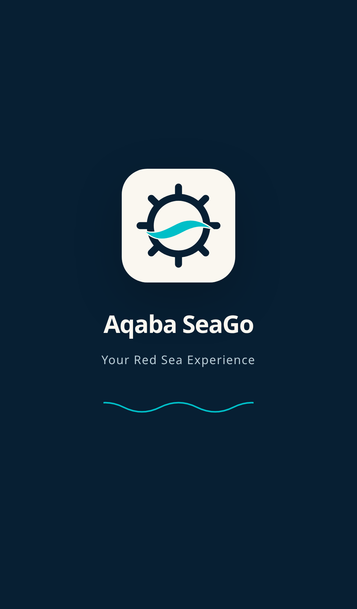
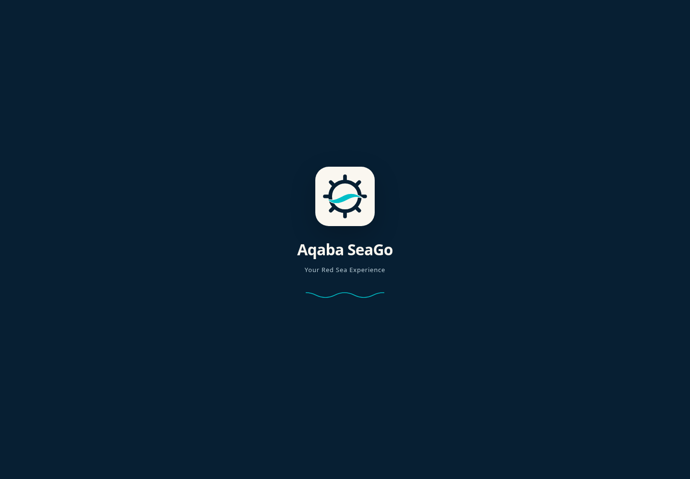

# Customer launch splash

The existing static recovery surface from PR #249 is also the animated splash.
It is present in the first HTML response, with inline critical CSS, a navy
background, and the unchanged `public/app-customer.svg`. React does not replace
this surface or render another splash.

`index.html` owns a document-scoped clock. It waits for the artwork to decode,
the document to become visible, and two animation frames before starting.
Artwork loading has a two-second safety limit so a stalled image request cannot
hold the whole app indefinitely. The timer does not depend on component renders
or internal navigation. A full reload creates a new launch sequence.

| Visible time | Presentation |
| --- | --- |
| 0–500ms | Logo fades and scales from 0.85 to 1 |
| 500–1200ms | Four-pixel logo settle; brand name enters |
| 1200–2200ms | Subtitle enters; turquoise wave moves gently |
| 2200–2700ms | Branding holds |
| 2700–3000ms | Splash fades into the committed app |
| 3000ms | Overlay is hidden; root loses `inert` and `aria-hidden` |

The exit is part of the 3000ms total. Browser scheduling and suspended OS
processes can delay actual frames or timer callbacks. Reduced motion keeps the
same timing with static branding and no animated exit; the delayed retry control
appears in a single step.

`src/LaunchSplash.jsx` marks readiness after React commits the existing app.
For a restored account, `src/startupSession.js` first verifies the session through
the existing read-only notifications endpoint. Protected screens do not mount
while this check is pending. A 401 clears the expired session before `App` reads
it; network/server errors or an eight-second timeout retain branded recovery.
Account changes during verification require another check. Anonymous launches
and public password recovery keep their usual entry behavior.
The app continues its current authentication, trip loading, booking, checkout,
password recovery, notification, and payment-return behavior beneath the splash.
Readiness means the real app shell has committed; network inventory may still be
loading using the existing per-screen loading and error UI.

If React is late, branding and the delayed retry remain visible. Readiness
within the last 300ms shortens the exit to the remaining time; readiness after
three seconds reveals the app immediately. Script loading failures, startup
exceptions, and React render failures retain the branded retry state. A partially
populated root no longer counts as a successful boot. The retry link preserves
the current URL, including recovery and payment-return parameters. With JavaScript
disabled, the same HTML remains visible and the CSS-delayed retry still works.

Vite `%BASE_URL%` resolves the critical logo/preload at Render/Capacitor root
and GitHub Pages subpaths. The existing service worker does not cache app shells.
The iOS standalone status bar uses the opaque black policy to avoid a white
launch strip while retaining the existing reserved content area. PWA launcher
assets and all native launcher icons remain unchanged.

Native setup and limitations are documented in [MOBILE.md](MOBILE.md). Generated
Android/iOS projects are ignored by the repository; existing native checkouts need
the splash-only resource generation and a native rebuild to adopt these changes.

## Verification

Run `npm test` in `customer-app` for all Customer tests, including the executable
bootstrap tests with a fake clock and native-resource fixture tests. Run
`npm run build` for the root build and `GITHUB_ACTIONS=true npm run build` for
the Pages build. No runtime or test dependencies were added.

Browser QA used Playwright with Chromium for iPhone and Pixel viewport emulation,
desktop, reduced motion, navigation, and disabled JavaScript. Screenshots below
show the real app in the browser; mobile screenshots are viewport emulation,
not physical device certification.

The optional `scripts/launchSplashBrowserQA.mjs` checks actual timing, console
errors, unhandled rejections, navigation/reload, a blocked module, a React render
failure, and initialization delayed beyond three seconds. Set `SPLASH_TEST_URL`
to a running Vite/preview URL. `PLAYWRIGHT_MODULE` can point to an isolated
Playwright `index.mjs`; `CHROME_PATH` can select an installed Chromium executable.
Screenshots default to `/tmp/seago-splash-evidence`.
The harness substitutes empty CSS for the existing optional Google Fonts import
and verifies system font fallback. An initial unmocked check observed an external
font certificate error in this environment; application JavaScript did not throw.
The splash uses system fonts and does not require that external request.

`scripts/launchSessionBrowserQA.mjs` tests delayed successful, 401, and 503 session
checks without contacting a backend. Start a separate Vite instance on port 4176
with `VITE_API_BASE_URL=http://127.0.0.1:4176/__qa_api`; the harness intercepts all
API calls and ensures cached profile content stays unmounted past three seconds.

Executed checks: 70 Customer tests, 101 selected existing regression tests, root
and Pages production builds, Chromium viewport/failure/session checks, native
asset fixture tests, shell syntax, and a librsvg render of the native composition.
The native renderer preserves the approved source bytes and square proportions.

**NOT VERIFIED:** physical iPhone/Android launches, installed PWA system UI, native
SDK builds, and Safari/WebKit rendering. WebKit downloaded successfully but could
not launch because the host lacks its GTK/graphics libraries. Production booking
and payment transactions were not performed.

| iPhone viewport | Desktop |
| --- | --- |
|  |  |

[Static recovery with JavaScript disabled](docs/splash/recovery.png)
