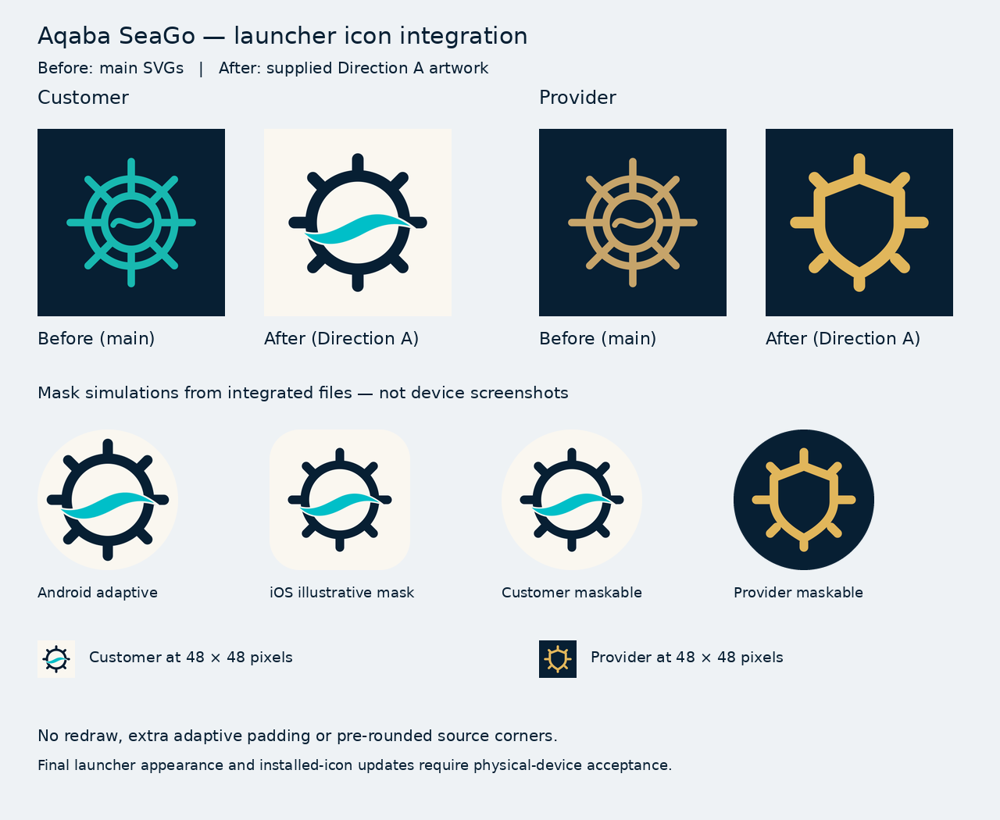

# Aqaba SeaGo launcher icons — Direction A

The final user-supplied **Aqaba-SeaGo-A-Icon-Package.zip** is integrated on
`fix/launcher-icons-platform-integration`, in
[PR #238](https://github.com/mohammadalnablsi701-del/-aqaba-seago/pull/238).
No merge, deployment or store release is performed. Physical-device acceptance
remains outstanding; builds and mask simulations do not replace it.

## Architecture discovered

| Experience | Technology and location | Platforms actually present |
| --- | --- | --- |
| Customer | React 18 / Vite 6 / Capacitor 8, `customer-app/` | Android, iOS, PWA |
| Provider | React 19 / Vite 8, `provider-app/` | Separate PWA only |

There are two independent web applications. Only Customer has a native wrapper:
`Aqaba SeaGo`, ID `com.aqabaseago.app`, `webDir: dist`. There are no Provider native
targets, IDs, build flavors or role-based alternate icons. Customer native projects
are generated and gitignored. Real native integration runs through
`customer-app/scripts/generate-native-assets.sh` after `cap add`, before `cap sync`,
in the existing Android/iOS workflows. Those release workflows are unchanged.

Separate PWA manifests provide distinct install icons today. A native Provider
launcher icon would require a separate Capacitor wrapper around its existing web
app plus agreed identifiers/signing. The supplied Provider Android layers do not
create that architecture; no unused Provider Android/iOS resources are added.

## Approved source and fidelity

Supplied archive SHA-256:
`12219a3031cb7fe85fa2851394471eca40c91c4cce8a6ee94c4bd2d7b8e65749`.

All 30 entries in the supplied `SHA256SUMS.txt` were verified. The supplied
`build_assets.py` was not executed. Eight self-contained SVGs contain editable
geometry without raster embedding, fonts or external references. Independent
SVG rendering comparisons against the supplied PNGs also matched after compositing.

| Role | Exact approved design | Repository source |
| --- | --- | --- |
| Customer | Ivory `#FAF7F0`, navy `#071F33` helm, turquoise `#00BFC8` wave | `customer-app/assets/logo.svg`, identical `public/app-customer.svg` |
| Provider | Navy `#071F33`, gold `#E1B65B` shield-shaped helm | `provider-app/public/app-provider.svg` |

Customer native source rasters and editable layers in `customer-app/assets/`:

- `icon-master-1024.png` — SHA-256 `2d55cb2824adc48e29dfdc421740737626103402329b4cdd3b57553f695d2bb4`.
- `android-adaptive-foreground.svg` and `android-adaptive-foreground-432.png` — supplied transparent composition, unchanged.
- `android-adaptive-background.svg` and `android-adaptive-background-432.png` — supplied opaque ivory background, unchanged.

The source files and all ten public PNGs are copied byte-for-byte from the package.
No redrawing, automatic tracing, adaptive layer padding, emblem rescaling or
pre-rounded corners are introduced. This avoids the earlier fidelity failure
documented in PR #230. The separately approved PWA maskable exports intentionally
share master pixels because the delivered geometry already fits their safe circle.

## Integration and outputs

| Platform | Customer output | Provider output |
| --- | --- | --- |
| Android legacy and round | `mipmap-{mdpi,hdpi,xhdpi,xxhdpi,xxxhdpi}/ic_launcher{,_round}.png`: 48, 72, 96, 144, 192 px | No native app |
| Android adaptive | Transparent `ic_launcher_foreground.png`: 108, 162, 216, 324, 432 px; separate ivory background XML; both `mipmap-anydpi-v26/ic_launcher{,_round}.xml` references | No native app |
| iOS | Every entry in `AppIcon.appiconset/Contents.json`; current Capacitor 8 template declares `AppIcon-512@2x.png`, universal 1024×1024, RGB without alpha | No native app |
| PWA regular | `customer-icon-a-v1-{192,512}.png`, purpose `any` | `provider-icon-a-v1-{192,512}.png`, purpose `any` |
| PWA maskable | `customer-maskable-a-v1-{192,512}.png`, purpose `maskable` | `provider-maskable-a-v1-{192,512}.png`, purpose `maskable` |
| Apple touch | `customer-apple-touch-icon-a-v1.png`, 180×180 RGB | `provider-apple-touch-icon-a-v1.png`, 180×180 RGB |
| SVG favicon/fallback | `app-customer.svg` | `app-provider.svg` |

The native 1024 iOS file and 432 adaptive foreground are byte-identical to their
supplied masters. Other native sizes are downsampled directly from those originals.
Transparent density conversion uses Lanczos2: its antialiased pixels stay within
the safe circle at mdpi; default Lanczos3 produced faint ringing outside the circle.
This changes the sampling filter, not the approved geometry or composition.
The generator checks actual alpha coverage at every density and fails on clipping.

Android's existing manifest still references `@mipmap/ic_launcher` and
`@mipmap/ic_launcher_round`. Both adaptive XMLs now reference only the approved
foreground and separate ivory background. Old unreferenced Capacitor template
drawables cannot override these references. Unexpected adaptive resource qualifiers
or existing monochrome definitions require review rather than silent overwriting.
Monochrome art was intentionally omitted from the supplied package and the current
template has no such reference, so none is invented.

Both HTML files and manifests use `direction-a-v1` cache versions and new PNG
filenames. Manifest names, start URLs, scope, display mode, background/theme metadata
and build bases are preserved. Customer `sw.js` changes only its notification icon
path. Neither service worker has a fetch cache; no cache-clearing code is added.

Removed stale PNGs: Customer `apple-touch-icon-v4.png`, `customer-icon-192.png`,
`customer-icon-512.png`, `icon-192.png`; Provider `apple-touch-icon.png`.
The old Customer 512 had an invalid IDAT CRC and unused legacy 192 was truncated.
There are no remaining live references to those paths. Installed OS/browser icon
metadata may still retain the previous image until refreshed or reinstalled.

Splash artwork is independent (`assets/splash.svg`) and unchanged. `--icons-only`
preserves splash files; existing default workflow calls retain the same splash
generation. No splash reference depends on the replaced icon source.

## Files changed

- Approved Customer source SVG/PNG and adaptive layers under `customer-app/assets/`.
- Customer native shell/Python generators and asset documentation / `MOBILE.md`.
- Both `index.html` files, `public/manifest.webmanifest` files, public SVG/PNG icons,
  and only the Customer notification icon path in `public/sw.js`.
- `scripts/verify-launcher-icons.mjs`, `.github/workflows/launcher-icons.yml`:
  read-only CI validation without dependencies or changes to deployment commands.
- `scripts/prepare-pwa-icons.sh`: retained review-only tool; candidate output stays
  outside the repository, and no legacy Apple filename is reintroduced.
- This report and `docs/branding/launcher-before-after.png`.

No package/dependency, app name/ID, Firebase, signing/certificate, permission,
UI/business/backend, environment/production setting or database change is included.

## Tests actually executed

| Check | Result |
| --- | --- |
| Supplied archive checksums; 18 role PNGs CRC/full decode/dimensions/alpha | PASS |
| Both PWA SVGs and ten PNGs byte-identical to supplied artwork | PASS |
| PWA manifest/HTML/notification references; manifest metadata preservation | PASS |
| Maskable marked-pixel radii at 192 / 512 | Both roles 71.43 ≤ 76.80 px / 189.52 ≤ 204.80 px |
| Native generation on actual Capacitor 8 templates, 15 Android PNGs plus one iOS PNG | PASS |
| Adaptive alpha radii for 108, 162, 216, 324, 432 layers | 31.82 ≤ 33; 47.50 ≤ 49.5; 62.95 ≤ 66; 94.50 ≤ 99; 125.51 ≤ 132 px |
| iOS catalog mapping, 1024 RGB/no alpha, exact supplied bytes | PASS |
| Android XML references and background SVG/PNG/XML consistency | PASS |
| Icon rerun image hashes | PASS, deterministic |
| All 14 existing splash PNGs preserved in icons-only and default modes | PASS, byte-identical |
| `npm run build`, Customer and Provider | PASS, existing hero-path / bundle-size warnings only |
| `cap sync android` and `cap sync ios` | PASS |
| Node icon validator for both applications | PASS |
| Validator rejects actual historical corrupted512, wrong dimensions and unexpected alpha | PASS |
| Native rejection of non-square/transparent input and existing monochrome override | PASS |
| Shell/Python/Node syntax and `git diff --check` | PASS |

The new icon-integrity workflow repeats the PNG full decode/CRC, format, size,
safe-zone and reference checks on PRs. The existing Mobile Native Build workflow
provides Android debug APK, unsigned release AAB and unsigned iOS simulator checks.
See PR #238 for the exact pushed commit and its CI evidence; earlier preparation-only
CI results are not evidence for the final artwork revision.

Reproduce locally (native directories must already exist):

```sh
node scripts/verify-launcher-icons.mjs customer
node scripts/verify-launcher-icons.mjs provider
cd customer-app
bash scripts/generate-native-assets.sh all --icons-only
```

## Preview and unverified items



The comparison uses the baseline `main` SVGs and integrated Direction A output.
Masks are simulations, not device screenshots. No crop or distortion was observed
in source geometry, measured bounds or these previews.

Linux here has no Android SDK or Xcode; no local native compilation is claimed.
Remote build results are reported separately in the PR. Still unverified:
physical Android circle/rounded-square/OEM launchers, actual iPhone/Safari Add to
Home Screen and native installation/update behavior, old installed-icon cache
refresh, signed APK/IPA/store distribution and Provider native delivery.
The PWA preparation tool was not executed on macOS Bash 3.2.

Keep PR #238 unmerged pending review and physical-device acceptance. Refreshing an
installed shortcut may require removing/re-adding that shortcut; never clear app
data as an icon fix. No deployment or live cache mutation was performed.
