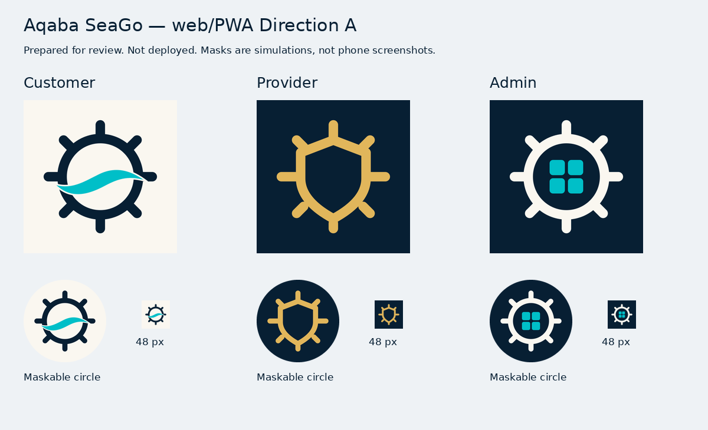

# GitHub Pages / PWA icon delivery

Status: prepared and tested on a separate branch; **not merged or published**.
The three live links still serve the older icons. A successful build does not
establish that an installed Android/iPhone icon has updated.

Branch: `fix/pages-pwa-direction-a-icons`, based directly on current `main`
`32717483c7ed8ea055301e02269c0e680907c318`.

## What is actually live

Public HTTP GET audit on 2026-11-04 found:

| Link | HTTP | Icon currently referenced by published HTML | Published manifest finding |
| --- | --- | --- | --- |
| [Customer](https://mohammadalnablsi701-del.github.io/-aqaba-seago/) | 200 | Old teal helm on navy; old Apple180 | Old PNG192/512 plus SVG; **512 PNG CRC is invalid** |
| [Provider](https://mohammadalnablsi701-del.github.io/-aqaba-seago/provider/) | 200 | Old gold helm on navy; old Apple180 | SVG only; missing PNG192/512 fallbacks |
| [Admin](https://mohammadalnablsi701-del.github.io/-aqaba-seago/admin/) | 200 | Old silver helm on navy; old Apple180 | **512 PNG CRC is invalid**; old192 exceeds the maskable safe circle |

All linked icon endpoints returned HTTP 200, including the corrupt PNGs. Status200
is therefore insufficient evidence of a usable icon. See the saved
[public HTTP/hash/decode audit](branding/pages-live-audit-2026-11-04.json).

Live `version.json` reports commit
`60c0f9caa2e4a95d148ad2f410366907b9766859`, built `2026-10-11T19:46:55Z`.
The [latest Pages run](https://github.com/mohammadalnablsi701-del/-aqaba-seago/actions/runs/38169411460)
matches that commit. This is an old server-side deployment, not evidence that
Direction A was published and merely hidden by a phone cache.

[PR238](https://github.com/mohammadalnablsi701-del/-aqaba-seago/pull/238) remains
open and unmerged at `a61c7244dd915c08df730614c9df3e52f9f26b63`. Its native source,
generation, identities and acceptance gate are not changed by this branch.

## Three prepared identities

| Application | Prepared design | Approval/source |
| --- | --- | --- |
| Customer | Ivory background, navy helm, turquoise wave | Exact approved Direction A SVG/PNG bytes from PR238 and the supplied original package |
| Provider | Navy background, gold shield-shaped helm | Exact approved Direction A SVG/PNG bytes from PR238 and the supplied original package |
| Admin | Navy background, ivory eight-handle helm, four turquoise dashboard tiles | Concept generated for review; requester explicitly approved with **«اعتمده»**; precise editable SVG constructed for final exports |

Customer/Provider masters are not redrawn. Their PNG48 favicons also come directly
from the supplied original Direction A package. The new Admin vector uses the same
family geometry/stroke and solid palette; it is an original precise construction,
not a pixel-identical trace of the generated concept raster. The concept approval
does not establish physical-device acceptance.

Admin source: `admin-app/public/admin-favicon-a-v1.svg`, 1024-unit square canvas,
navy `#071F33`, ivory `#FAF7F0`, turquoise `#00BFC8`. Four 100-unit rounded tiles
have 20-unit gaps; the helm matches the family's rounded 62-unit strokes. The
[1024 review master](branding/admin-direction-a-master-1024.png) and
[concept reference](branding/admin-direction-a-proposal.png) stay in documentation,
outside the built website. No unapproved proposal raster is wired into the apps.

## Wiring and cache strategy

Each app has its own independent paths within its existing directory:

- `<role>-favicon-a-v1.svg` and `<role>-favicon-a-v1-48.png`: SVG plus PNG browser fallback.
- `<role>-apple-touch-icon-a-v1.png`: opaque RGB180 for Safari home-screen metadata.
- `<role>-icon-a-v1-{192,512}.png`: manifest purpose `any`.
- `<role>-maskable-a-v1-{192,512}.png`: separately named manifest purpose `maskable`.
- `<role>-manifest-a-v1.webmanifest`: active versioned manifest filename.

`manifest.webmanifest` remains an exact compatibility alias in each app. Previously
installed PWAs and existing build validators can still fetch that URL, now with
the correct new icon references. The existing `app-<role>.svg` aliases also contain
the correct new art; active favicon URLs use new names. Old corrupt/stale PNGs are
retired after updating all live references. Cache query tokens are consistent.

Manifest names, `short_name`, `start_url`, `scope`, display/background/theme
metadata and application URLs are unchanged. No new manifest ID is introduced.
Provider/Admin manifests resolve under their own subdirectories and never borrow
Customer icons. Customer's notification icon path is the only service-worker
change. Existing workers have no fetch/CacheStorage cache to purge.

No code clears cookies, localStorage, IndexedDB, sessions or caches; no logout,
worker unregistration or user-data deletion is added. New resource filenames can
avoid stale HTTP images, but cannot force iOS/Android to replace an already pinned
icon. Test a fresh installation separately from an existing installation update.
Do not delete an installed PWA or clear its storage as an automatic cache remedy;
on some devices that can remove application data or authentication state.

## Pages preparation without deployment

Existing `.github/workflows/pages.yml` builds Customer at `/-aqaba-seago/`, copies
Provider to `provider/` and Admin to `admin/`, then uploads `customer-app/dist`.
Those base paths, build commands, trigger policy, production API selection and
deployment permissions/actions are unchanged. A read-only validation step now
checks the final merged icon URLs before artifact upload.

New `.github/workflows/pages-icons-preview.yml` runs on pull requests with
`contents: read` only. It builds all 3 apps from lockfiles, assembles the same
directory structure outside the source tree, tests it over local HTTP and uploads
a review artifact. It has no Pages configuration/deployment action, id-token grant
or production concurrency group. It cannot cancel or trigger a Pages deployment.

Helpers:

- `scripts/verify-web-icons.mjs <customer|provider|admin>`: full PNG CRC/decode,
  RGB/noalpha, dimensions, safe circles, HTML/manifest/notification references and
  active/compatibility-manifest equality. It has no native asset dependency.
- `scripts/assemble-pages-preview.mjs --out=<new directory outside repo>`: merges
  the 3 built applications and rejects output collisions/recursive source copying.
- `scripts/verify-pages-icon-paths.mjs --dist=<merged artifact>`: serves the artifact
  at `/-aqaba-seago/`, checks browser-resolved scopes/start URLs, both manifest
  names, image MIME/bytes, JS/CSS paths and application ownership of every URL.
  Missing files return 404; no SPA fallback can hide a missing icon.

## Tests actually executed

| Test | Result |
| --- | --- |
| Public HTTP/hash/decode audit of all 3 existing links | Complete; old deployment and defects documented above |
| Locked dependency installation and web builds for all 3 with exact Pages bases | PASS; existing Customer hero warning / Provider bundle-size warning only |
| Existing production-API/build-base validators for all 3 | PASS; forbidden Staging API absent |
| Final merged preview HTTP paths, MIME, source-byte equality and app ownership | PASS, 39 HTTP responses |
| Customer/Provider SVG+PNG fidelity to approved originals | PASS, byte-identical |
| Admin SVG geometry, PNG full decode/CRC/opacity and export fidelity | PASS |
| Maskable marked-pixel radii for all 3 | 71.43 ≤76.80px at192;189.52 ≤204.80px at512 |
| Favicon PNG48, Apple180, regular/maskable192/512 formats and dimensions | PASS for all 3 |
| Reject actual historical Customer/Admin corrupt512 and wrong dimensions | PASS |
| Reject Provider-to-Customer favicon path and changed compatibility alias in merged artifact | PASS |
| Chromium 155 persistent profiles, desktop and mobile viewport | All 6 page cases: PNG/SVG/Apple image decode PASS, no manifest or installability errors reported |
| Workflow YAML, Node/worker syntax and `git diff --check` | PASS |

[Browser check evidence](branding/pages-browser-preview-check.json) records the
actual decoded paths and sizes. Browser requests were restricted to the local
artifact; this test did not contact production API endpoints. Temporary browser
test profiles are not real user profiles.

Chromium mobile viewport checks use the Chromium engine. They do **not** test
Safari/WebKit, physical home screens or an OS-driven icon update. No native build
or device acceptance is claimed by this web-only PR. CI results for the pushed
web-only commit belong in its PR, separately from PR238's earlier build results.

## Remaining acceptance and publication

1. Review the final3-app artwork/export preview and web-only diff.
2. Test fresh Add to Home Screen for all 3 apps on physical Android and iPhone
   Safari, plus existing-install icon refresh without clearing user data.
3. Check round/maskable crops, labels and separate Provider/Admin scope/identity.
4. Decide publication after reviewing these results; no merge or manual Pages
   dispatch has been performed in this task.
5. After an authorized deployment, fetch live `version.json`, HTML, active and
   compatibility manifests, all favicon/Apple/PNG/SVG endpoints, and compare their
   hashes with the exact deployed artifact. Then record actual device observations.
   Do not substitute a successful build for either check.

PR238 must remain unmerged until its separate native device requirements are met.
After this web-only change is accepted, its duplicate web hunks should be reconciled
in PR238 before any later native merge, so older filenames cannot be reintroduced.

No native assets/config/generators/workflows, names/IDs, dependency versions,
booking/payment/QR/check-in/UI/backend/Firebase logic, permissions, secrets or
production business/database settings are changed. Production Pages source files
are prepared for a future approved deployment; the live site is not modified.
